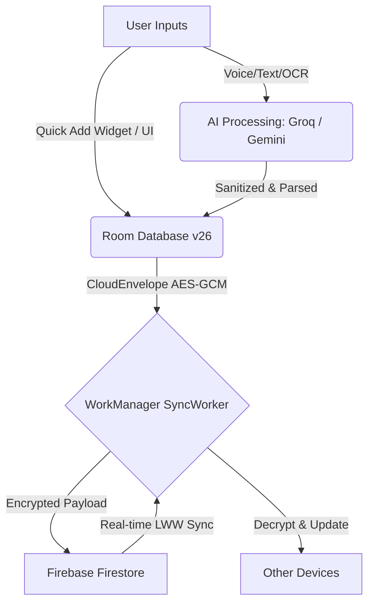

# Spend Tracker - Comprehensive Architecture & Features

Spend Tracker is a highly advanced, offline-first Android application designed for intelligent expense tracking, total privacy, and multi-device synchronization. 

Below is an exhaustive breakdown of the app's features, directly mapped to the underlying screens, components, workers, and data layers found in the codebase.

---

## 🏛 Core App Flow & Architecture

- **Architecture Strategy**: Single-Activity (`MainActivity.kt`), state-based navigation (no `NavController`), and MVVM via `SpendViewModel`.
- **Database**: Local source of truth uses **Room v26** (`AppDatabase.kt`) across 7 distinct tables (`spends`, `history`, `recurring_bills`, `notes`, `note_entries`, `note_history`, `chat_messages`).
- **Security**: AES-GCM Envelope Encryption (`CloudEnvelope.kt`) seals all cloud data. Android Biometric APIs protect app launch and sensitive sheets.

---

## 📱 Detailed Screen & UI Component Mapping

### 1. Dashboard & Analytics (`DashboardScreen.kt`)
- **Dashboard Cards** (`DashboardCards.kt`): Displays total spent, transaction count, top payment apps, and recent activity.
- **Spending Charts** (`SpendingCharts.kt`): Renders dynamic donut/bar breakdowns for categories.
- **Budget Editor** (`BudgetEditorDialog.kt`): Allows setting target limits per category/month with real-time over-spending warnings.
- **Date Filtering** (`DateRangePickerModal.kt`): Advanced filtering for Today, Week, Month, Year, Custom Range, and Project Dates.
- **Monthly Wrapped Banner** (`WrappedBanner.kt`): A dynamic banner appearing on days 1-7 of the month to showcase previous month's recaps.

### 2. Smart Inputs & AI Overlays
- **Voice & AI Overlays**: `VoiceInputOverlay.kt` handles native microphone inputs with waveform UI, while `AiInputBottomSheet.kt` handles typed natural language.
- **AI Batch Confirmations**: `AiBatchConfirmationScreen.kt` lists multiple parsed transactions (e.g., *"Food 50 and Cab 100"*) for batch approval, while `AiConfirmationScreen.kt` handles single approvals.
- **Add Spend** (`AddSpendScreen.kt`): Traditional, highly-customizable manual entry utilizing `CategorySelectionGrid.kt` for visual presets.
- **AI Settings**: Configured via `AiSettingsDialog.kt`.

### 3. History & Dues (Lending/Borrowing)
- **Main History** (`HistoryScreen.kt`): Displays a unified timeline of all standard spends, categorized by optimized month headers (`MonthSections.kt`).
- **Lend & Borrow** (`LendBorrowScreen.kt` & `LendBorrowHistoryScreen.kt`): Explicitly isolated screens tracking Dues. Groups transactions by person name to instantly show who owes you (and who you owe).

### 4. Notes Management (`NotesScreen.kt`)
- **Note Management**: Manage custom notes via `NotesScreen.kt` with options to toggle between Grid and List (Normal) views.
- **Note History & Trash**: `NotesHistoryScreen.kt` acts as a 30-day Recycle Bin for soft-deleted notes. 
- **Conversions**: Users can use batch actions to import, copy, move multiple notes, and even "Log Note as Transaction".

### 5. Recurring Bills & Subscriptions (`RecurringBillsScreen.kt`)
- **Bill Tracking**: Managed directly in `RecurringBillsScreen.kt` and `BillTrackingBottomSheet.kt`.
- **Subscription Finder UI**: Surfaces auto-detected monthly payment patterns as actionable suggestions.

### 6. Settings, Privacy & Auth
- **Authentication**: Modular `AuthComponents.kt` drives the `LoginScreen.kt` and `RegisterScreen.kt`, mandating Email Verification and Google Sign-up (via Credential Manager).
- **Settings** (`SettingsScreen.kt`): Controls app defaults, multi-device Room sync triggers, themes (OLED Black, Pitch Black, Dark, System Default), and sign sounds.
- **Privacy & Profile**: Handled via `PrivacyPolicyDialog.kt` and `ProfileDialog.kt`.

### 7. Conversational AI Assistant
- **AI History Sheet** (`AiHistoryAssistantSheet.kt`): An interactive chat layer capable of fetching history, recurring bills, and specific notes securely without hallucinating math totals.

---

## ⚙️ Background Workers (`worker/`)

The app relies heavily on Android `WorkManager` to execute background logic flawlessly:

1. **`SyncWorker.kt` (Data Sync)**
   - Runs on a 3-hour periodic interval.
   - Pushes all local Room Database updates to Firebase Firestore using a Last-Write-Wins (LWW) conflict check based on `updatedAt`.
2. **`RecurringBillWorker.kt` (7-Day Reminders)**
   - Checks the `RecurringBillDao` daily.
   - Pushes Android System Notifications **7 days in advance** of a bill's due date, and again twice on the actual day (12:30 PM & 10:00 PM). 
   - Interacts with `NotificationActionReceiver.kt` to allow 1-tap "Mark as Paid" idempotency.
3. **`RecapWorker.kt` (Weekly & Monthly Wrapped)**
   - Runs daily at ~7 PM. Generates 100% on-device weekly spending recaps (Sundays) and Monthly Wrapped notifications (Days 1-3 of the month).

---

## 🧠 Data & AI Processing Logic (`data/` & `assistant/`)

### Advanced AI Processing
- **AI Parsers**: `AiParser.kt` serves as the offline baseline, while `AiTransactionProcessor.kt` manages Groq/Gemini calls. `AiBatchParser.kt` splits multi-expense sentences.
- **Correction Memory**: `AiCorrectionMemory.kt` and `AiCorrectionRepository.kt` locally save user edits to AI predictions, training future offline/online inputs via an internal DataStore.
- **PII Sanitization**: `PiiSanitizer.kt` automatically scrubs personal data (names, phones, UPIs) before the query leaves the device.
- **Exact Math Fetching**: `HistoryQuery.kt` calculates the mathematical totals natively from the Room DB before sending context to the AI Assistant.

### External Integrations & OCR
- **Receipt OCR**: `ReceiptOcrText.kt` and `ReceiptTextReader.kt` utilize local ML Kit to read screenshots/receipts shared via `SharedPaymentText.kt`.
- **System Assistants**: `SpendlyAppFunctions.kt`, `VoiceTracker.kt`, and `VoiceTrackPlanner.kt` hook into Android 16+ AppFunctions, allowing Gemini/Assistant to log spending directly in the background.

### Widgets (`widget/`)
- **`QuickAddWidget.kt`**: Home screen widget for instantaneous manual addition. Handled by `QuickAddInputActivity.kt` and `QuickAddViewModel.kt`.
- **`SpendSummaryWidget.kt`**: Displays real-time daily/monthly totals, updated automatically via `SpendSummaryWidgetUpdater.kt` using Room invalidation trackers.
